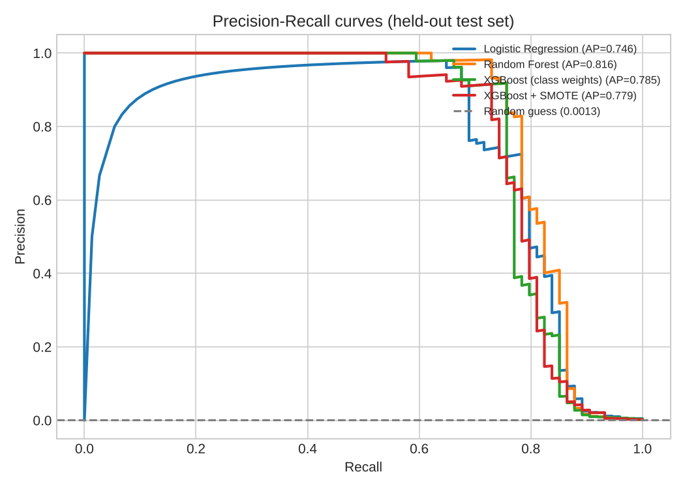
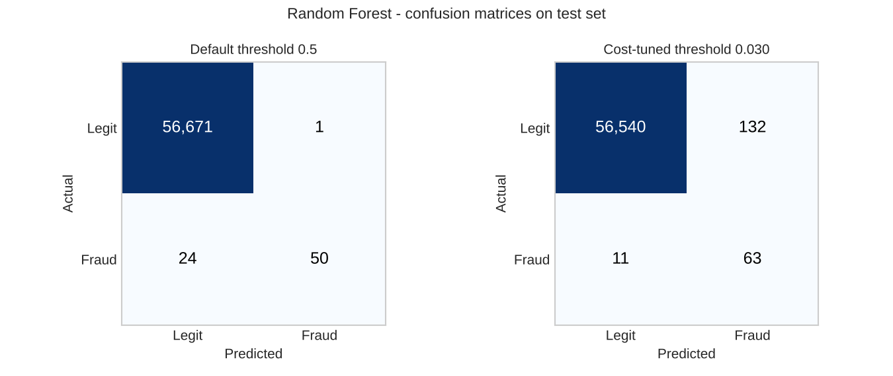
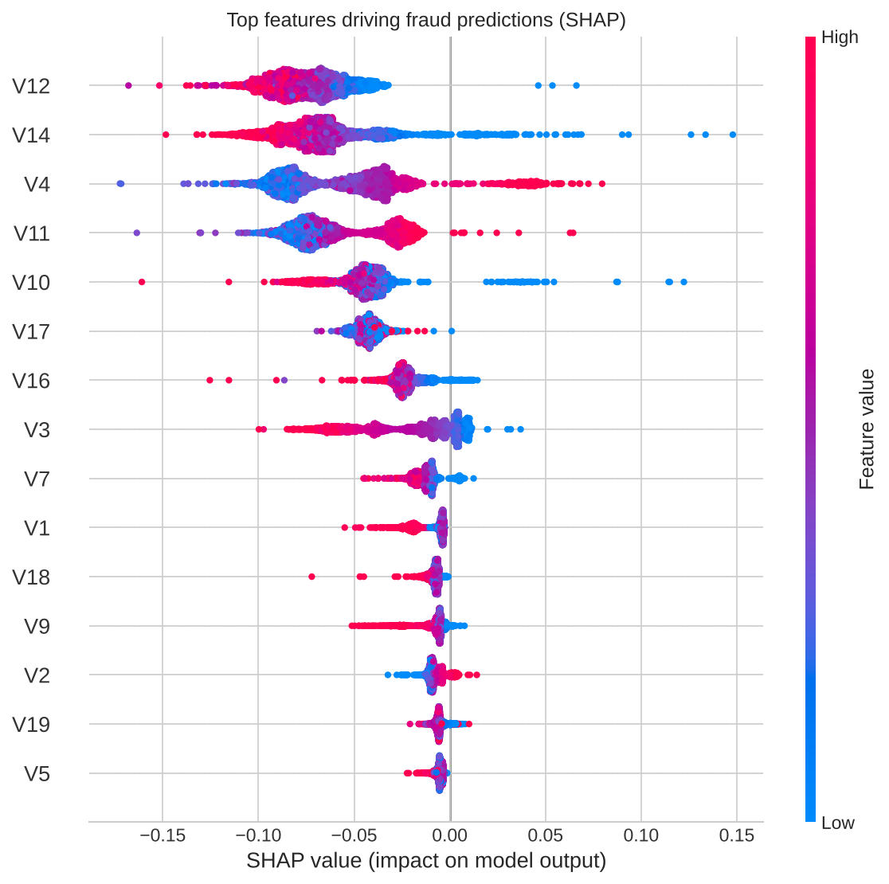

# Credit Card Fraud Detection

End-to-end machine learning project that detects fraudulent card transactions on a **highly imbalanced** dataset
(0.167% fraud), with a leakage-free time-based evaluation, a business-cost-driven alert threshold,
SHAP explanations and a Streamlit app.

**Dataset:** [Credit Card Fraud Detection (ULB) on Kaggle](https://www.kaggle.com/datasets/mlg-ulb/creditcardfraud) -
284,807 European card transactions over two days; features `V1-V28` are anonymised PCA components, plus `Time` and `Amount`.

## Results (held-out test period: 56,746 transactions, 74 frauds)

| Model | Val PR-AUC | **Test PR-AUC** | Test ROC-AUC |
|---|---|---|---|
| Logistic Regression | 0.760 | 0.746 | 0.983 |
| Random Forest | 0.780 | 0.816 | 0.952 |
| XGBoost (class weights) | 0.773 | 0.785 | 0.978 |
| XGBoost + SMOTE | 0.773 | 0.779 | 0.971 |

Selected model: **Random Forest** (best validation PR-AUC). The differences between the tree models are
within noise - with only 74 test frauds, one or two transactions move PR-AUC by a point or more.

| Alert threshold | Precision | Recall | Frauds caught | False alarms | Frauds missed |
|---|---|---|---|---|---|
| Default 0.5 | 98.0% | 67.6% | 50 | 1 | 24 |
| **Cost-tuned 0.03** | 32.3% | **85.1%** | 63 | 132 | 11 |

**Business impact (assumption-driven):** if a missed fraud costs its full amount and every flagged transaction costs
5 currency units to review, the tuned threshold reduces fraud-related cost by
**56.8%** versus having no model (7,728 -> 3,337).
The review cost is *my assumption*, not part of the dataset - change `REVIEW_COST` in `src/train.py` to see how the optimal threshold moves.





## Approach

1. **Data checks** - no missing values, but 1,081 exact duplicate rows, which are removed so they can't leak across the split.
2. **Chronological split (60/20/20)** - train on the past, tune on the middle, test on the future. A random split would overstate performance.
3. **Four models compared** - class-weighted Logistic Regression, class-weighted Random Forest, XGBoost with `scale_pos_weight`, and XGBoost + SMOTE (oversampling applied to the training fold only).
4. **PR-AUC, not accuracy** - always predicting "legit" is 99.8% accurate and useless. ROC-AUC is also flattering here (all models > 0.95).
5. **Threshold chosen on validation data by minimising cost**, then evaluated once on the untouched test period.
6. **SHAP** to see what drives predictions and to sanity-check the model.

### A mistake I caught
My first feature set had an `is_round_amount` flag. SHAP showed the SMOTE model had learned *"round amount => legitimate"*.
Cause: SMOTE **interpolates** between real fraud rows, so synthetic frauds never have round amounts and the model learned an
artefact. I removed the discrete flags (see the note in `src/common.py`). Lesson: don't combine SMOTE with binary/discrete features.

## Project structure
```
app.py                       Streamlit app (score one transaction, batch CSV scoring, performance tab)
src/common.py                data loading, feature engineering, time split
src/train.py                 full training + evaluation pipeline (writes models/, reports/, figures)
notebooks/01_fraud_eda_and_modeling.ipynb   EDA and walkthrough (executed)
models/fraud_model.joblib    trained model + threshold
reports/metrics.json         all metrics from the last training run
data/sample_transactions.csv 100 real held-out transactions for the demo (25 fraud)
```

## Run it
```bash
python -m venv .venv && source .venv/bin/activate      # Windows: .venv\Scripts\activate
pip install -r requirements.txt

# App (works immediately - model and demo sample are included)
streamlit run app.py

# To retrain: download creditcard.csv from Kaggle into data/ then
python src/train.py
```

## Limitations (be upfront about these)
- Only **two days** of data and **74 test frauds** -> wide uncertainty; results are not production-grade evidence.
- Features are anonymised, so the model's behaviour can't be explained in business terms beyond "V14, V12... matter".
- `hour` is derived from seconds since the first transaction, which assumes the data starts near midnight; it ended up unimportant anyway.
- No concept-drift monitoring, no probability calibration, and the cost model is assumed.
- The final model is trained on the first 60% only (no refit on train+val) to keep the evaluation clean.
